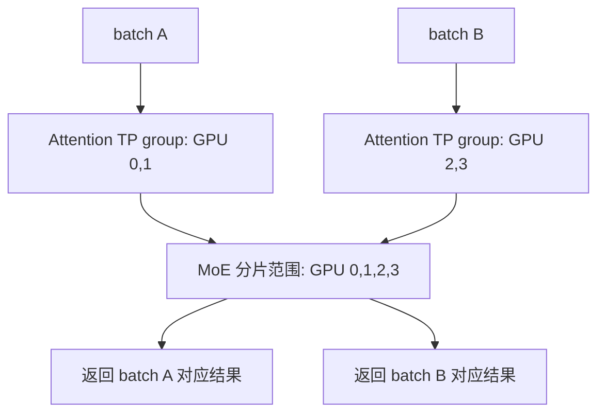

# vLLM v0.30.0 并行策略源码导读

对于 MoE 模型，纯 TP、DP+EP 和 DP+TP+EP 的区别，首先在于 Attention 与专家层怎样使用同一批 GPU：Attention 可以在不同 DP 副本间复制、在 TP 组内切分；专家层则把这些设备重新组织成一个更大的分片范围。在这个范围内，可以切分每个专家的矩阵，也可以把完整专家分配到不同设备。

本文沿用 v0.9.0 分析中“进程组 → 权重切分 → token 通信 → forward”的阅读顺序，基于当前 `v0.30.0-docs` 分支的实现。源码基线为 `v0.30.0`，对应提交 `ced6857afa0ea7b2e3f0846a62e1394e90f15607`；当前分支相对该 tag 已有的改动仅涉及文档。

讨论以 GPU、V1 engine 和通用 `FusedMoEFactory` 路径为主。模型自带的专用 MoE 实现、不同量化 kernel 和硬件后端可能另有约束，不能仅根据进程组大小判断某个组合一定可以运行。文中的简化代码均用于说明控制流，省略了量化、padding、异常处理等细节。

## 从 v0.9.0 到 v0.30.0：先更新哪些认识

| 旧版分析中的关注点 | v0.30.0 的实现 |
| --- | --- |
| rank 布局为 `ExternalDP × DP × PP × TP` | 增加 PCP，变为 `ExternalDP × DP × PP × PCP × TP` |
| MoE 在 `DP × TP` 上重新分片 | 通用配置扩展为 `DP × PCP × TP`；`PCP=1` 时退化为旧公式 |
| 非 PPLX 路径使用 broadcast、all-reduce、split | 默认后端为 `allgather_reducescatter`，核心操作是 `all_gatherv` 和 `reduce_scatterv` |
| `pplx` 是优化的 all-to-all 路径 | `pplx`、`naive` 后端已移除；传入旧名称会警告并回退到默认后端 |
| `FusedMoE` 同时管理权重、路由和 forward | 拆为 `FusedMoEFactory`、`MoERunner`、`RoutedExperts`、router、prepare/finalize 与 expert kernel |
| `FusedMoEModularKernel` 串联通信与计算 | 当前外层抽象为 `FusedMoEKernel`，包含 modular 和 monolithic 两类实现 |
| SP 主要指 TP 中的序列并行优化 | 要区分编译器 SP、MoE 输入的 token 切分，以及处理长上下文的 PCP/DCP |
| PPLX forward 按固定 token chunk 迭代 | 不能照搬旧路径；当前还要区分后端容量、CUDA graph padding、microbatch 和 DBO |

其中，**“是否切分专家”与“怎样发送 token”仍是两个独立问题**。开启 EP 决定专家权重的归属；选择通信后端决定 dispatch/combine 的实现。默认 EP 仍可通过 all-gather/reduce-scatter 完成通信，并不保证只发送路由命中的 token。

版本依据：[ParallelConfig](../../vllm/config/parallel.py)、[MoE 配置](../../vllm/model_executor/layers/fused_moe/config.py)、[MoE 工厂](../../vllm/model_executor/layers/fused_moe/layer.py)。

## 并行维度分别切分什么

下文使用 `T=TP`、`D=DP`、`P=PP`、`C=PCP`，没有特别说明时 `P=C=1`。

| 策略 | 主要切分对象 | 权重或状态的典型分布 | 是否增加独立进程维度 |
| --- | --- | --- | --- |
| TP，Tensor Parallelism | 同一层的矩阵、attention heads 等 | 设备持有权重分片，共同完成一层计算 | 是 |
| PP，Pipeline Parallelism | 模型层 | 不同 stage 持有不同层及其 KV cache | 是 |
| DP，Data Parallelism | 请求与 batch | Attention 等非专家部分在 DP 副本间复制；MoE 专家仍可跨 DP 分片 | 是 |
| EP，Expert Parallelism | routed experts | 每个 rank 持有一部分完整专家 | 否，复用 `D × C × T` 个 rank |
| PCP，Prefill Context Parallelism | 同一个请求的 prefill token 计算 | 非专家权重沿 PCP 轴复制，token 计算分担；专家参与更大的 MoE 分片 | 是 |
| DCP，Decode Context Parallelism | 上下文 KV cache 与 attention 计算 | 沿 token 维度分片 KV，并合并 attention 结果 | 否，复用已有 TP/PCP rank |
| SP，Sequence Parallelism | 部分算子的 token 维度 | 在已有 TP rank 间改变激活布局 | 否 |

这里的“DP 副本”是请求调度与 Attention 的视角。对于 MoE，它不一定拥有一套可以脱离其他副本独立推理的完整专家权重。

常规启动路径中，一个 DP rank 的 executor 使用：

```text
workers_per_dp_rank = P × C × T
total_model_workers = D × P × C × T
```

GPU 一进程一卡时，这也是模型 worker 的 GPU 数量；不包括 API server 等 CPU 进程。EP、DCP 和 SP 不应再乘到这个公式中。`ParallelConfig.__post_init__()` 实际计算的 `world_size` 包含 PCP；`external_launcher` 对该字段另有包含 DP 的处理，阅读日志时要区分配置字段与全局分布式 world。

## 进程组：同一张卡同时属于多个组

### rank 布局与组的构造

[initialize_model_parallel()](../../vllm/distributed/parallel_state.py) 中的核心布局为：

```python
all_ranks = torch.arange(world_size).reshape(
    -1,
    data_parallel_size,
    pipeline_model_parallel_size,
    prefill_context_model_parallel_size,
    tensor_model_parallel_size,
)
```

最外层是源码称为 `ExternalDP` 的维度，用来容纳模型外部的独立数据并行布局。以下例子固定该维度，使用普通静态进程组；elastic EP 会改用可重建的 stateless DP/EP group。

在这一布局下，TP 固定其他坐标、变化 TP 坐标；DP 固定其他坐标、变化 DP 坐标。PP 与 PCP 同理。EP 则固定 PP stage，把 DP、PCP、TP 三个坐标展平：

```text
EP group size = D × C × T
EP rank       = dp_rank × C × T + pcp_rank × T + tp_rank
```

EP 不跨 PP stage，因为不同 stage 存放的是不同层的专家。DCP 也不是外加的独立维度，其组从已有 TP/PCP rank 中构造。

### 四卡例子：DP=2、TP=2

令 `PP=PCP=1`：

| 全局 rank | DP rank | TP rank | Attention 使用的请求 |
| --- | --- | --- | --- |
| 0 | 0 | 0 | batch A |
| 1 | 0 | 1 | batch A |
| 2 | 1 | 0 | batch B |
| 3 | 1 | 1 | batch B |

对应组为：

```text
TP groups: [0, 1], [2, 3]
DP groups: [0, 2], [1, 3]
EP group:  [0, 1, 2, 3]
```

`[0,1]` 是处理 batch A 的一个 TP 组；`[0,2]` 是不同 DP 副本中 TP 坐标相同的进程集合。不要把源码里的 DP group 与“一个完整 DP 副本拥有的全部 GPU”混用。

batch A 和 batch B 来自独立调度，它们的请求数、token 数可以不同，也不一定是某个固定 batch 的各一半。旧文对 `[0,2]`、`[1,3]` 的解释应据此修正。



对于 MoE，`initialize_model_parallel()` 即使在没有开启 EP 时也可能创建 `_EP`：该组还承载跨 DP 的 MoE 通信。因此，**看到 `get_ep_group().world_size == 4` 不代表已经按专家切分权重**。是否启用专家切分，要看 `FusedMoEParallelConfig.use_ep`。明确为 dense 的模型不会创建这套 EP group。

### 加上 PP 后，EP 按层所在的 stage 分组

若 `DP=2、PP=2、TP=2、PCP=1`，共 8 个 worker：

```text
TP groups: [0,1], [2,3], [4,5], [6,7]
PP groups: [0,2], [1,3], [4,6], [5,7]
DP groups: [0,4], [1,5], [2,6], [3,7]
EP groups: [0,1,4,5], [2,3,6,7]
```

两个 EP group 分别服务 PP stage 0 与 stage 1 上的 MoE 层，不能把 8 个 rank 看成同一个 EP group。

## Attention 的 TP 与 MoE 内部的 TP 是两套数值

### Attention 如何使用 TP

以 [Qwen3 MoE](../../vllm/model_executor/models/qwen3_moe.py) 为例，QKV 投影使用 `QKVParallelLinear`，输出投影使用 `RowParallelLinear`。普通路径中，TP rank 计算局部 heads，输出投影产生的部分结果在 TP 组内求和。

因此，`TP=1、DP=4` 时，每个 DP 副本拥有完整 Attention 权重；`TP=2、DP=2` 时，每个副本的 Attention 由两张卡协作完成。开启 EP 不会把 Attention 的权重切分大小改成 `EP=4`。

这里的“切分 Attention”也不意味着所有张量都严格按 `1/T` 缩小。GQA/MQA 在 KV heads 少于 TP ranks 时会复制部分 KV heads；MLA 有自己的投影与 KV 表示。优化路径还可能将输出 all-reduce 改写为 reduce-scatter，不能认为任何模型的 Attention 末尾都固定执行一次独立 all-reduce。

### FusedMoEParallelConfig 重新解释分片范围

[FusedMoEParallelConfig.make()](../../vllm/model_executor/layers/fused_moe/config.py) 的关键逻辑可以写成：

```python
flat_size = dp_size * pcp_size * tp_size
flat_rank = dp_rank * pcp_size * tp_size + pcp_rank * tp_size + tp_rank
use_ep = flat_size > 1 and parallel_config.enable_expert_parallel

if use_ep:
    moe_tp_size, moe_tp_rank = 1, 0
    moe_ep_size, moe_ep_rank = flat_size, flat_rank
else:
    moe_tp_size, moe_tp_rank = flat_size, flat_rank
    moe_ep_size, moe_ep_rank = 1, 0
```

`dp_size` 和 `pcp_size` 仍保留，用于数据布局与通信。展平后的 `moe_tp_size` 用来决定专家矩阵的分片宽度，并不表示代码创建了另一个同名 `_TP` 组；跨 DP、PCP 和 TP 的通信可以分阶段完成。

这解释了两个容易混淆的事实：

1. **不启用 EP 时，MoE 也可以跨 DP 切分。** `DP=2、TP=2` 的 Attention 使用 TP=2，而通用 MoE 的有效 TP=4。
2. **启用 EP 后，通用路径中的单个专家不再同时做 TP。** MoE 内部 TP 变为 1，完整专家分布在 `D×C×T` 个 rank 上；Attention 的 TP 保持原配置。

### 从权重形状看 TP 与 EP

假设有 `E` 个 routed experts，hidden size 为 `H`，每个专家的 intermediate size 为 `I`，使用 gate/up/down 三个投影。忽略量化、padding、bias、shared experts 和 EPLB 冗余副本：

| 模式 | 每卡专家数 | 每卡 intermediate size | `w13` 形状 | `w2` 形状 |
| --- | --- | --- | --- | --- |
| MoE TP，大小 `S=D×C×T` | `E` | `I/S` | `[E, 2I/S, H]` | `[E, H, I/S]` |
| MoE EP，大小 `S=D×C×T` | 约 `E/S` | `I` | `[E/S, 2I, H]` | `[E/S, H, I]` |

例如 `E=8、I=4096、DP=2、TP=2`：

- 关闭 EP：每卡有 8 个专家的矩阵分片，每个分片 intermediate size 为 1024。
- 开启 EP：均匀放置时每卡有 2 个完整专家，每个专家 intermediate size 为 4096。

在整除且没有额外开销的理想情况下，两种方式每卡专家权重规模相近。真正变化的是矩阵计算形状、token 送达范围、路由负载与通信方式，不能仅凭“开启 EP”推断显存占用一定更小。

依据：[FusedMoEConfig.**post_init**()](../../vllm/model_executor/layers/fused_moe/config.py)、[未量化专家权重创建](../../vllm/model_executor/layers/fused_moe/unquantized_fused_moe_method.py)、[ExpertMapManager](../../vllm/model_executor/layers/fused_moe/expert_map_manager.py)。通用 expert map 能表达不均匀专家数，但某些通信后端、kernel 和 EPLB 仍要求整除。

## 当前 MoE 的构建与 forward 调用链

### FusedMoEFactory 组装计算组件

旧文中的大类已被拆开。[FusedMoEFactory()](../../vllm/model_executor/layers/fused_moe/layer.py) 现在依次构建以下组件，并默认返回一个 `MoERunner`：

| 组件 | 主要职责 |
| --- | --- |
| `FusedMoEParallelConfig` / `FusedMoEConfig` | 分片大小、rank、输入布局、专家数、kernel 所需尺寸 |
| `ExpertMapManager` | 全局专家与本地专家的映射、专家放置、部分后端的路由表 |
| `FusedMoERouter` | 根据 router logits 选择 top-k 专家及权重，接入 EPLB 等路由逻辑 |
| `RoutedExperts` | 持有专家权重、加载分片，通过 quant method 调用实际专家计算 |
| `MoERunner` | 串联 gate、路由、专家计算、通信兼容路径、shared experts 与结果归约 |
| `FusedMoEKernel` | 配对 prepare/finalize 与 expert kernel，检查二者接口和激活布局是否匹配 |

通信后端也分两层：[CudaCommunicator](../../vllm/distributed/device_communicators/cuda_communicator.py) 创建相应 all-to-all manager；[maybe_make_prepare_finalize()](../../vllm/model_executor/layers/fused_moe/all2all_utils.py) 根据 MoE 配置、量化配置和后端选择 prepare/finalize，并获取通信 handle/buffer。expert kernel 则由对应的量化方法和 `oracle/` 中的后端选择逻辑决定。

因此，`--all2all-backend` 选择的是通信实现，不是直接选择某个 GEMM kernel。两者最终必须在 activation format、量化方式、专家布局等条件上匹配。

### modular 与 monolithic 的路由位置不同

[MoERunner._apply_quant_method()](../../vllm/model_executor/layers/fused_moe/runner/moe_runner.py) 区分两种路径：

```text
modular:
    router.select_experts(hidden_states, router_logits)
        → topk_weights, topk_ids
    RoutedExperts.forward_modular(...)
        → quant_method / FusedMoEKernel

monolithic:
    RoutedExperts.forward_monolithic(hidden_states, router_logits, ...)
        → 在 kernel 路径内部处理路由与专家计算
```

对 modular 路径，`FusedMoEKernelModularImpl` 的逻辑骨架仍与旧文相似：

```text
prepare 或 prepare_async
    → 量化、dispatch、生成专家 token 元数据
experts.apply
    → token 排列、专家矩阵计算、激活、输出整理
finalize 或 finalize_async
    → top-k 加权/归并、combine、恢复调用方需要的布局
```

但这些职责可以被融合，不保证每一步都是独立 kernel；top-k 加权也可能在专家计算或 combine 内完成。当前接口支持异步 receiver/hook，而不是简单调用两个同步 Python 函数。

### 兼容路径仍可能在 runner 外围通信

`MoERunner._forward_impl()` 中仍有 `_maybe_dispatch()` 和 `_maybe_combine()`。当 `DP>1` 或输入为 SP，且 quant method 没有内部 modular-kernel 支持时，runner 会调用 `dispatch_router_logits()` 与 `combine()`。PCP 在没有走 all-to-all kernel 时，还会在外围执行 PCP all-gather/reduce-scatter。

另一类实现把通信封装在 prepare/finalize 内部。这意味着读取调用链时，必须先判断 `supports_internal_mk`、`use_all2all_kernels` 和 `is_monolithic`，不能把外围 dispatch 与内部 prepare 中的 dispatch 当成每个模型都要执行的两次通信。

## 三种典型 MoE 数据流

下面固定 `DP=2、TP=2、PP=PCP=1`，不讨论 shared experts，先看请求 token 如何在四张卡间移动。

### 关闭 EP：DP 请求，专家矩阵做四路 TP

Attention 后，rank 0、1 持有 batch A 的激活，rank 2、3 持有 batch B 的激活。专家矩阵则按有效 TP=4 切分，因此每个 token 都需要四份矩阵分片共同完成计算。

在默认通信路径中：

1. 在 DP groups `[0,2]`、`[1,3]` 内 all-gather，使每个 rank 都获得 A、B 的 token 及对应路由信息。
2. 每个 rank 使用本地专家矩阵分片，计算 A、B 的部分输出。
3. 在 DP 方向 reduce-scatter：汇总这一方向上的部分结果，并把 A 的结果留给 DP rank 0，把 B 的结果留给 DP rank 1。
4. 在 TP groups `[0,1]`、`[2,3]` 内完成剩余求和，得到各自 batch 的完整输出。

可以把这里的求和理解为沿两个轴分解：

```text
sum over 4 MoE tensor shards
    = sum over DP axis, followed by sum over TP axis
```

如果模型选择延迟归约或融合操作，TP 求和可能发生在调用方；语义仍是把所有必要的部分结果加起来。不能把逻辑上的四路 TP 简化成“只在一个四卡 TP group 中执行一次 all-reduce”。

### 开启 EP，使用默认 allgather_reducescatter

此时 rank 0～3 持有不同完整专家。通用模型在满足 `use_sequence_parallel_moe` 条件时，会先把 TP 组内重复的 token 切成互不重叠的部分。

以 [Qwen3MoeSparseMoeBlock.forward()](../../vllm/model_executor/models/qwen3_moe.py) 的显式切分路径为例，设 A 有 4 个 token，B 有 2 个 token：

```text
Attention 输出：
    rank 0: [a0,a1,a2,a3]     rank 1: [a0,a1,a2,a3]
    rank 2: [b0,b1]           rank 3: [b0,b1]

sequence_parallel_chunk 后：
    rank 0: [a0,a1]           rank 1: [a2,a3]
    rank 2: [b0]              rank 3: [b1]
```

之后：

1. EP group 上 `all_gatherv`，每个 rank 获得 `[a0,a1,a2,a3,b0,b1]` 及路由信息。
2. 各卡只计算路由到本地专家的贡献。
3. EP group 上 `reduce_scatterv` 汇总贡献，把结果按 `[2,2,1,1]` 分回原来的 token 所有者。
4. 模型在各自 TP group 中 all-gather，恢复 A 或 B 的完整激活，再交给后续计算。

这个路径的专家确实已分散到各卡，但 dispatch 仍把全体 token 收集到每个 EP rank。它与后面的按路由发送路径有实质区别。

实际 batch 可能需要 padding，切分也不一定像例子中这样恰好整除。`DPMetadata` 的 SP 大小记录负责描述每个 rank 参与通信的 token 数；恢复后还要裁掉 padding。

### 开启 EP，使用按路由发送的后端

以 DeepEP 为例，输入准备成适合通信的 token 布局后，先计算 top-k 路由，再根据专家位置决定 token 的目的 rank。一个 token 的 top-k 专家若分布在多张卡上，就需要送达相应设备；若多个命中专家位于同一设备，具体复制与去重由后端处理。


与 all-gather 相比，这类 dispatch 可以避免把所有 token 发送到所有 rank，但收益取决于 top-k、专家分布、通信网络、batch 大小、量化和负载偏斜。不能仅从接口名字推导固定的通信量或速度提升。

还有一个边界情况：**`TP>1、DP=PCP=1` 的 TP+EP 可以不走上述 all-to-all kernel 路径**。如果模型没有额外设置 SP，每个 TP rank 已有同一批 token，可各自计算本地完整专家的贡献，再在 TP 组内求和。`enable_expert_parallel=True` 本身不足以让 DeepEP 的 prepare/finalize 生效。

## dispatch/combine 的具体实现

### 默认后端的通信组不一定就是 EP group

[AgRsAll2AllManager](../../vllm/distributed/device_communicators/all2all.py) 中的选择逻辑是：

```python
def _get_comm_group(self, is_sequence_parallel):
    if is_sequence_parallel:
        return get_ep_group()
    if self.dp_world_size > 1:
        return get_dp_group()
    return get_pcp_group()
```

`dispatch_router_logits()` 收集 hidden states、router logits 和可选额外张量；`dispatch()` 收集 hidden states、top-k IDs、top-k weights 和可选 scales 等张量。两者底层都是 `all_gatherv`。`combine()` 使用 `reduce_scatterv`，同时完成求和与按 token 数切回本地。

因此，在 EP communicator 上调用 `dispatch()`，不等于底层一定在整个 EP group 上执行 collective。SP 输入、DP 输入和 PCP 输入对应的通信范围不同。

`naive_dp_ep.py` 中仍有 `MoEPrepareAndFinalizeNaiveDPEPModular` 等类名。这些类封装当前的基础通信路径，不能据此认为旧版 `NaiveAll2All` 的逐 rank broadcast 实现仍然是默认后端。

### DeepEP high-throughput

[DeepEPHTPrepareAndFinalize](../../vllm/model_executor/layers/fused_moe/prepare_finalize/deepep_ht.py) 的主要流程是：

1. 处理输入量化；例如可分发支持的 FP8 block scales，其他情况可能在 dispatch 后量化。
2. 调用 `buffer.get_dispatch_layout()`，从 top-k IDs 得到各目的 rank、RDMA rank 和专家的 token 分布。
3. 调用 `buffer.dispatch()`，得到接收的 token、路由信息、专家 token 数、通信 handle/event。
4. 将后端返回的路由信息转换为 vLLM expert kernel 需要的表示，执行专家计算。
5. 使用对应 handle 进行 combine，恢复源端的 token 输出。

它使用 `Standard` 激活布局，核心张量可以理解为 `[received_tokens, H]`，同时携带专家 token 元数据。HT 是为吞吐设计的通信路径，但不应把名称当作任何 prefill workload 上都更快的保证。

### DeepEP low-latency

[DeepEPLLPrepareAndFinalize](../../vllm/model_executor/layers/fused_moe/prepare_finalize/deepep_ll.py) 使用 `low_latency_dispatch()` / `low_latency_combine()`，激活格式为 `BatchedExperts`：

```text
[num_local_experts, token_capacity_per_expert, hidden_size]
```

有效 token 数由 `ExpertTokensMetadata` 表达，第二维是容量，不能把 padding 都当成实际参与计算的 token。dispatch 返回的 handle 与接收 hook 会供异步流程和 combine 使用。该路径的 combine 负责相应加权归并，`output_is_reduced()` 返回 `True`。

这也是为什么不能在任何 EP forward 末尾都无条件追加一次 TP all-reduce。`MoERunner` 会检查 kernel 的 `output_is_reduced()`、是否 SP、是否延迟归约，以及 shared expert 输出是否已经归约，决定后续操作。

当前还接入 `deepep_v2`、`nixl_ep`、`mori_high_throughput`、`mori_low_latency` 和 FlashInfer NVLink one-sided/two-sided 后端。`flashinfer_all2allv` 是 two-sided 后端的旧别名。可选名称见 [ParallelConfig](../../vllm/config/parallel.py)，实际配对分支见 [all2all_utils.py](../../vllm/model_executor/layers/fused_moe/all2all_utils.py)；依赖和硬件条件见 [EP 部署文档](../serving/expert_parallel_deployment.md) 与 [EP kernels 工具](../../tools/ep_kernels)。

### 两个“使用 all-to-all”的判断不能混为一谈

| 判断 | 当前含义 |
| --- | --- |
| `ParallelConfig.use_all2all` | 是否需要在 communicator 中配置相应通信能力；`DP>1` 即可能成立，即使没有开启 EP |
| `FusedMoEParallelConfig.use_all2all_kernels` | `use_ep and (DP>1 or PCP>1 or is_sequence_parallel)`，决定当前 MoE 是否进入对应 kernel 通信路径 |

没有 EP 的 DP+TP 路径仍需要跨 DP 收集和归约 token，所以前者成立并不代表使用按路由分发的 EP kernel。

## SP、PCP 与 DCP：都涉及 token，但作用不同

### MoE 的 SP：消除 TP 输入复制带来的重复发送

`ParallelConfig.use_sequence_parallel_moe` 是模型实现可以采用的策略。当前公共判断要求开启 EP、`TP>1`、`DP>1`，且后端属于代码列出的集合：`allgather_reducescatter`、DeepEP HT/LL、FlashInfer one-sided、MoRI HT/LL 或 NIXL EP。

这个列表不是所有后端的全集，不能假定任意后端都会触发同样的 token 切分。`FusedMoEFactory` 也允许模型传入 `is_sequence_parallel`，最终还要检查模型的实际调用。

Qwen3 MoE 的例子是“进 MoE 前局部切分，出 MoE 后 TP all-gather”。[DeepSeek V2/V3 实现](../../vllm/model_executor/models/deepseek_v2.py) 则有让 Attention 输出直接 reduce-scatter、保持 residual 分片、向 MoE 传入 `already_sequence_parallel=True` 的路径。这能减少先生成完整副本再切分的工作，但也说明数据布局不能只在 MoE 工厂里追踪。

### 编译器 SP：改写部分算子前后的 collective

另一类 SP 位于 [sequence_parallelism 编译 pass](../../vllm/compilation/passes/fusion/sequence_parallelism.py)，由 `CompilationConfig.pass_config.enable_sp` 等配置控制。它匹配支持的图模式，将相关通信与 Norm 等计算改写为适合 token 分片的形式，复用 TP 组。

它与模型显式的 MoE SP 是不同入口。不能认为开启编译器 SP 就设置了 `use_sequence_parallel_moe`，也不能把两者描述为增加一个独立的 GPU 维度。hidden size、平台能力与图模式都会影响是否应用优化。

### PCP：分担长 prefill 的计算

PCP 在物理 rank 布局中增加一维。当前 [PCPManager](../../vllm/v1/worker/gpu/pcp_manager.py) 由 Model Runner V2 使用，负责切分输入 batch、维护局部/全局 token 映射与 attention 输入，并在采样前恢复 hidden states。prefill 的切分还需要考虑 causal attention 前后位置的工作量差异，不能等同于任意均分 token 数后各算各的。

`_iter_rank_chunks()` 将需要切分的 prefill 分为 `2×PCP` 块，每个 rank 取前后配对的两块。例如 `PCP=4` 时，rank 0 取第 0、7 块，rank 1 取第 1、6 块，以此类推，使较早位置与较晚位置的计算搭配。decode query 会复制；启用 DCP 时，过短而不能填满这些块的 prefill 也走复制路径。最终由 `restore_hidden_states()` 执行 PCP all-gather，再按保存的索引恢复原 token 顺序。

对 MoE 来说，不同 PCP rank 也可能持有不同 token，所以其角色可以进入原有 DP/TP 展平公式：

```text
MoE sharding size = DP × PCP × TP
```

PCP 本身不会自动增加 KV cache 的分片数。KV cache 是否以及如何沿上下文分片，还要看 DCP 和 attention backend。

**进程组支持 PCP，并不意味着所有模型和并行组合都支持 PCP。** 本版本 `PCPManager.validate_config()` 明确限制：目前仅支持 MLA 模型；不支持 PP、多模态输入、encoder-decoder 或 LoRA；PCP+DCP 进一步要求 sparse MLA，且 DCP 通信后端为 `ag_rs`。推测解码和 CUDA graph 模式也有单独校验。旧的 context-parallel 介绍页中“prefill 仍在开发”等泛化描述，不能替代这里的运行时检查。

### DCP：复用已有 rank，分片 KV cache

DCP 不额外增加进程数量。当 `PCP=1` 时，它复用 TP ranks，配置要求 `TP % DCP == 0`。对于 GQA/MQA，模型校验还要求 TP 大于 KV head 数，且 DCP 不超过 `TP / num_kv_heads`，query heads 与 KV heads 的比例也有整除约束。

例如 4 个 KV heads、`TP=8` 时，每个 KV head 会在 TP 中出现复制；`DCP=2` 可用于沿上下文拆分这些副本持有的 KV。MLA 的 KV 表示与约束不同，应沿相应 attention 实现继续阅读。

当 `PCP>1` 时，`ParallelConfig` 允许的 DCP 大小为 `1`、`PCP` 或 `TP×PCP`，进程组按 PCP 优先的顺序展开。例如 `TP=2、PCP=2`：

```text
rank 坐标 (pcp_rank, tp_rank):
    0=(0,0), 1=(0,1), 2=(1,0), 3=(1,1)

DCP=2: groups [0,2], [1,3]
DCP=4: group  [0,2,1,3]
```

这些是配置层允许的拓扑，仍须通过前述 PCP 与具体模型的运行时检查。DCP 会通信并合并 attention 的部分结果，包括与 softmax 归一化相关的信息；不能简单对各卡的局部 attention 输出直接求和。

依据：[并行配置校验](../../vllm/config/parallel.py)、[模型校验](../../vllm/config/model.py)、[进程组实现](../../vllm/distributed/parallel_state.py)、[Context Parallel 部署说明](../serving/context_parallel_deployment.md)。

## DP 调度、PP 流水线与通信同步

### MoE 的不同 DP rank 不能任意跳过 forward

DP rank 可以拥有不同请求和不同长度的 batch，但参与同一 MoE 通信域的 rank 仍要以兼容顺序执行 collective。某个 rank 没有请求，不代表它可以直接退出，留下其他 rank 等待 dispatch/combine。

[EngineCore 的 DP 循环](../../vllm/v1/engine/core.py) 会在需要时让空闲 rank 执行 dummy batch，并协调各 rank 是否仍有工作。[coordinate_batch_across_dp()](../../vllm/v1/worker/dp_utils.py) 则协调 token 数、CUDA graph 模式和 microbatch 决策。需要 CUDA graph 或 microbatch 时，还可能把各 DP rank padding 到一致大小。

这也解释了两种负载均衡为什么要分开看：API 层将请求分配给 DP engines；EPLB 调整专家在设备上的负载。前者均衡请求数，并不保证后者的路由计算均衡。

在线服务提供 internal、hybrid 和 external DP load balancing 模式，详见 [DP 部署文档](../serving/data_parallel_deployment.md)。这些模式主要影响请求入口与 engine 部署，不会把已建立的 MoE EP 通信域变成完全独立的服务实例。源码布局中的 `ExternalDP` 也不能直接等同于 `--data-parallel-external-lb`。

### PP 切分模型层

PP 通过模型实现中的 `make_layers()` 等逻辑划分层范围；中间 stage 返回 `IntermediateTensors`，末级负责后续输出计算。需要模型实现 `SupportsPP`，并通过对应功能组合的检查。

PP 的通信对象主要是 stage 间激活。它可以降低每卡需要存放的层数，但会带来流水线依赖和空泡，单个请求不会因为分为多个 stage 就同时完成所有层。如何让多个 batch 在不同 stage 间推进，可继续阅读同目录的 [Scheduler 与 Model Runner 源码导读](scheduler_and_model_runner_v0.30.0.md)。

## 专家放置、EPLB 与 DBO

### 专家 ID 不等于永远固定的 GPU 编号

默认 `linear` 放置将连续专家分给各 rank。例如 8 个专家、EP=4 时，可表示为 `[0,1]`、`[2,3]`、`[4,5]`、`[6,7]`。`round_robin` 则交错放置，例如 `[0,4]`、`[1,5]`、`[2,6]`、`[3,7]`。

不过，`round_robin` 不是任意组合都可用的通用开关。本版本校验要求多 expert group、没有冗余专家且未开启 EPLB；进入 all-to-all kernel 路径时还有路由表支持限制，不满足会回退为 `linear`。应检查 [ExpertMapManager](../../vllm/model_executor/layers/fused_moe/expert_map_manager.py) 的策略校验，而不是只看 CLI 接受了参数。

EPLB 通过负载记录、专家重排和可选冗余副本缓解热点。`num_redundant_experts` 在工厂中加到全局专家数量上：它是每个 MoE 层增加的全局物理专家副本数，不是每张卡都额外增加这么多逻辑专家。

引入冗余副本后，需要区分模型的逻辑 expert ID、用于实际分发的物理 expert ID，以及 rank 本地的 expert index。路由选中的逻辑专家可以映射到一个物理副本，模型语义不应因此多算一个新的逻辑专家。

当前 `EPLBConfig` 的默认记录窗口为 1000、重排间隔为 3000、`use_async=True`。启用 EPLB 要求 EP 有效、多 rank、平台和专家 kernel 支持，工厂还检查物理专家数能否均匀分布。实现使用与 EP 成员相同但独立的 EPLB group，隔离权重迁移与 forward 通信。

elastic EP 进一步支持重建 DP/EP 拓扑，但不是普通静态 EP 的默认行为。当前配置要求 EPLB，且不支持 PP、external/hybrid DP load balancing 等组合。本文中的静态 rank 例子不用于解释扩缩容过程。

### DBO 重叠通信与计算

`--enable-dbo` 开启 Dual Batch Overlap，将工作划为两个 microbatch，在兼容实现中让一份计算与另一份通信重叠。它复用现有 GPU 和通信组，不改变 `EP=D×C×T`，也不是 PP。

`ParallelConfig` 的默认阈值为：纯 decode 的 `dbo_decode_token_threshold=32`，包含 prefill 的 `dbo_prefill_token_threshold=512`。实际是否 microbatch 还要经过跨 DP 协调；不会因为打开参数就对所有 batch 无条件切成两份。

DeepEP prepare/finalize 中可见 `dbo_current_ubatch_id()`、stream 切换及每个 microbatch 独立的 handle。当前 microbatch 配置校验仅允许 `deepep_high_throughput`、`deepep_low_latency` 和 `nixl_ep`，还会限制 DBO 与 PP、PCP/DCP、推测解码、LoRA 等功能的组合。它改变的是执行重叠方式，不能替代通信后端、专家负载或网络拓扑本身的选择。

旧文中的 `VLLM_ALL2ALL_BACKEND` 与 `VLLM_MOE_DP_CHUNK_SIZE` 已不在本版本 `vllm/envs.py` 的注册项中。新文档应使用 `--all2all-backend`，并分别说明 scheduler token 预算、后端 buffer 容量、padding 和 DBO；不能继续用“固定 256 token 的 PPLX chunk”概括当前 MoE forward。

依据：[ParallelConfig / EPLBConfig](../../vllm/config/parallel.py)、[功能组合检查](../../vllm/config/vllm.py)、[DP 协调](../../vllm/v1/worker/dp_utils.py)、[环境变量注册](../../vllm/envs.py)。

## 用配置例子对应上面的数据流

以下为 Linux shell 的单机配置示意。`MODEL` 应指向受支持的 MoE checkpoint 或本地目录；显存、专家数量整除、量化后端和模型支持仍须满足。命令用于说明拓扑，没有在本文编写过程中启动 GPU 服务或测量性能。

### 四卡纯 TP

```bash
vllm serve "$MODEL" \
    --tensor-parallel-size 4
```

Attention TP=4，MoE 有效 TP=4；每个 rank 都持有所有专家的矩阵分片。

### 四卡 DP+TP，关闭 EP

```bash
vllm serve "$MODEL" \
    --tensor-parallel-size 2 \
    --data-parallel-size 2
```

两个 DP engines 各使用 Attention TP=2，MoE 有效 TP=4。专家计算前后需要跨 DP 交换 token 和部分结果。

### 四卡 DP+EP

```bash
vllm serve "$MODEL" \
    --tensor-parallel-size 1 \
    --data-parallel-size 4 \
    --enable-expert-parallel \
    --all2all-backend allgather_reducescatter
```

Attention 在四个 DP 副本中完整复制；MoE EP=4。适合用来理解“请求分别做 Attention，专家跨四卡共享”的结构，但 Attention 复制和通信也会占用资源。

### 四卡 DP+TP+EP

```bash
vllm serve "$MODEL" \
    --tensor-parallel-size 2 \
    --data-parallel-size 2 \
    --enable-expert-parallel \
    --all2all-backend allgather_reducescatter
```

这是前文四卡例子：Attention TP=2，MoE EP=4。在模型采用公共 MoE SP 策略时，TP 重复输入会先按 token 切分。

安装并满足相应依赖后，可以将通信后端替换为 `deepep_high_throughput` 或 `deepep_low_latency` 等，再检查实际选中的 expert kernel 和通信布局。替换后端不会改变这里的 Attention TP 与 MoE EP 大小。

### TP+PP 与 TP+DCP

```bash
vllm serve "$MODEL" \
    --tensor-parallel-size 2 \
    --pipeline-parallel-size 2
```

使用四个 worker，但每个 PP stage 中的 MoE 只在本 stage 的两张卡上分片，不是四路 MoE TP。

对于满足 GQA/MQA 或 MLA 对应 DCP 条件的模型，可以另外考虑：

```bash
vllm serve "$MODEL" \
    --tensor-parallel-size 8 \
    --decode-context-parallel-size 2
```

仍使用八个 worker。DCP 调整 KV cache 与 attention 计算的分布，不把专家分片大小再乘二。PCP 的模型和功能限制更多，应先检查 `PCPManager.validate_config()`，再设计具体启动组合。

## 如何比较这些策略

源码能解释资源和通信如何分布，不能直接给出某个模型上的最佳配置。比较时需要固定 GPU 数、模型与量化方式，并记录输入/输出长度分布、并发度和 token 预算。

| 观察到的瓶颈 | 对应需要比较的策略或实现 |
| --- | --- |
| Attention 权重或计算压力较大 | 在固定卡数下调整 DP 与 TP 的比例；检查是否能承受 Attention 复制 |
| 专家矩阵切片过窄、TP 归约开销高 | 对比相同卡数的 MoE TP 与 EP，检查实际 GEMM 形状 |
| EP all-gather 传输量大 | 在兼容条件下对比按路由 dispatch 的通信后端 |
| 热门专家使部分 rank 拖慢整轮 | 查看每个专家和 rank 的 token 负载，评估放置策略与 EPLB |
| 长上下文 decode 的 KV cache 复制明显 | 检查 KV heads 与 TP 关系，再评估 DCP |
| 长 prefill 的计算时间过长 | 在当前支持范围内评估 PCP，记录其通信与输入重排开销 |
| MoE 通信与计算串行时间明显 | 在支持组合下评估 DBO，而非直接增加并行度 |
| 模型层无法在现有切分下放入显存 | 评估 PP，同时检查 stage 不均衡和流水线空泡 |

性能结果至少应区分 TTFT、每 token 延迟或 TPOT、总吞吐、尾延迟、显存与 KV cache 容量。对比 kernel/backend 时，还应做输出正确性或模型评测，避免把数值变化或工作负载变化误当成并行策略收益。

## 源码阅读入口

| 要回答的问题 | 入口 |
| --- | --- |
| 参数默认值、后端别名与并行组合校验 | [vllm/config/parallel.py](../../vllm/config/parallel.py) |
| TP/PP/DP/PCP/DCP/EP group 如何构造 | [parallel_state.py](../../vllm/distributed/parallel_state.py)：`initialize_model_parallel()` |
| MoE 的 TP/EP 大小与权重宽度如何计算 | [fused_moe/config.py](../../vllm/model_executor/layers/fused_moe/config.py) |
| 当前 MoE 由哪些组件组成 | [fused_moe/layer.py](../../vllm/model_executor/layers/fused_moe/layer.py)：`FusedMoEFactory()` |
| gate、路由、通信、shared experts 和归约如何串联 | [moe_runner.py](../../vllm/model_executor/layers/fused_moe/runner/moe_runner.py) |
| 权重加载与 quant method 调用 | [routed_experts.py](../../vllm/model_executor/layers/fused_moe/routed_experts.py) |
| 如何选择通信的 prepare/finalize | [all2all_utils.py](../../vllm/model_executor/layers/fused_moe/all2all_utils.py)：`maybe_make_prepare_finalize()` |
| prepare/expert/finalize 接口及数据布局 | [modular_kernel.py](../../vllm/model_executor/layers/fused_moe/modular_kernel.py)：`FusedMoEKernel` |
| 默认 dispatch/combine 的 collective | [device_communicators/all2all.py](../../vllm/distributed/device_communicators/all2all.py)：`AgRsAll2AllManager` |
| 专家放置及路由表 | [expert_map_manager.py](../../vllm/model_executor/layers/fused_moe/expert_map_manager.py) |
| DP batch 大小、graph 与 microbatch 如何协调 | [dp_utils.py](../../vllm/v1/worker/dp_utils.py)、[forward_context.py](../../vllm/forward_context.py) |
| PCP 输入切分与恢复、运行限制 | [pcp_manager.py](../../vllm/v1/worker/gpu/pcp_manager.py) |

理解一条具体推理路径时，可以依次确认：模型使用哪个 MoE 实现、实际传入的 TP/DP/PCP/SP 配置、专家权重怎样分片、prepare/finalize 选择了哪个后端、结果已经在哪一步完成归约。这样才能把部署参数、进程组、权重布局和运行时 collective 对应起来。
