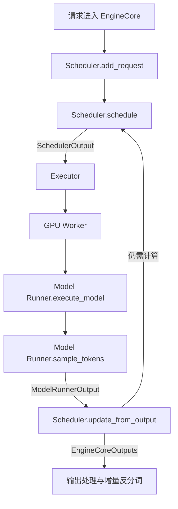
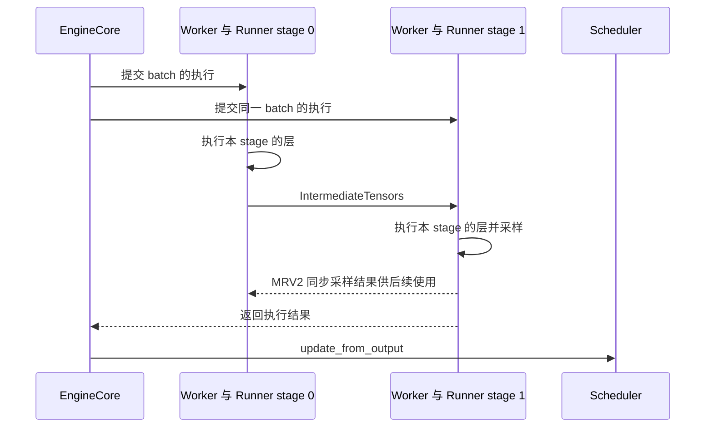

# vLLM v0.30.0 Scheduler 与 Model Runner 源码导读

Scheduler 决定每一步让哪些请求计算多少个 token，并为这些计算安排 KV cache；Model Runner 将调度结果转换成模型输入，执行 forward、采样和设备侧状态更新。EngineCore 连接二者，不断执行“调度、计算、回收结果”的循环。

本文对应 `v0.30.0`，源码基线为 `ced6857afa0ea7b2e3f0846a62e1394e90f15607`。以 GPU 上的自回归文本生成为主，解释异步调度、Model Runner V2 和 Pipeline Parallelism（PP）的连接方式。多模态、推测解码和 KV transfer 只讨论它们对主流程的影响。

## 版本与实现选择

这个版本使用 V1 engine，但同时保留两套 GPU model runner。**V1 engine 和 Model Runner V2 属于不同层次的版本命名**。

| 层次 | 实现 | 选择方式 |
| --- | --- | --- |
| Scheduler | `Scheduler` | 未使用自定义 scheduler，且关闭异步调度时 |
| Scheduler | `AsyncScheduler` | 未使用自定义 scheduler，且启用异步调度时；继承 `Scheduler` |
| GPU runner | MRV1：`vllm/v1/worker/gpu_model_runner.py` | 显式选择或兼容性回退 |
| GPU runner | MRV2：`vllm/v1/worker/gpu/model_runner.py` | 满足兼容条件时默认选择 |

`SchedulerConfig.async_scheduling` 的初始值是 `None`，随后由 `VllmConfig` 解析。普通生成任务在 executor 和功能组合兼容时默认开启；pooling 默认关闭，一些推测解码方法和 executor 也会限制它。显式开启不兼容的组合可能报错。

MRV2 的选择由 `VllmConfig.use_v2_model_runner` 决定。通常可以通过 `VLLM_USE_V2_MODEL_RUNNER` 显式控制；未设置时，会检查 Triton、平台、模型架构以及不支持的功能组合，再决定使用 MRV2 或回退 MRV1。HiSparse、watermarking 另有强制选择逻辑。**异步调度与 MRV2 是分别判断的两个选择，不能用其中一个推断另一个。**

源码入口：

- [scheduler 配置与类选择](../../vllm/config/scheduler.py)：`SchedulerConfig.get_scheduler_cls()`。
- [配置解析](../../vllm/config/vllm.py)：`use_v2_model_runner`、`_get_v2_model_runner_unsupported_features()` 和 `async_scheduling` 的解析分支。
- [GPU worker](../../vllm/v1/worker/gpu_worker.py)：`Worker.init_device()` 实例化 runner；启用 MRV2 时会记录 `Using V2 Model Runner`。

仓库中的 [MRV2 设计文档](../design/model_runner_v2.md) 适合理解设计动机；实际默认值、功能支持和类名应以本版本代码为准。

## 模块分工与调用链



图中是普通生成任务的逻辑闭环。异步模式下，多轮工作可以同时处于进行中；PP 中间级传递的是 `IntermediateTensors`，最后一级执行采样。

| 模块 | 主要职责 | 维护的数据 |
| --- | --- | --- |
| EngineCore | 创建 scheduler/executor，推进循环，管理在途 batch，回收输出 | batch queue、执行 future |
| Scheduler | 请求准入、token 预算、KV block 分配与回收、抢占、请求进度和结束状态 | `Request`、waiting/running、KV cache manager |
| Executor | 按执行后端分发 worker 调用，承接执行结果 | worker 集合、RPC/future |
| GPU Worker | 设备与分布式环境、模型初始化，以及 PP 中间张量通信 | device、通信状态、model runner |
| Model Runner | 维护执行侧请求状态，准备输入与 attention metadata，执行模型、采样 | 模型权重、KV cache 张量、输入缓冲、请求状态张量 |
| 输出处理 | 将 token 转为文本，组装面向调用方的结果 | 增量反分词和输出状态 |

Scheduler 通过 KV cache manager 管理 block 的归属和可用性；实际 KV 数据位于 worker 的设备内存中，由模型的 attention 等计算路径读写。调度得到 block ID，并不表示对应 token 的 KV 已经计算完成。

主循环在 [EngineCore](../../vllm/v1/engine/core.py) 中，分发接口见 [Executor](../../vllm/v1/executor/abstract.py)，文本处理见 [OutputProcessor](../../vllm/v1/engine/output_processor.py)。

## Scheduler 如何推进请求

### 请求状态与 token 进度

[Request](../../vllm/v1/request.py) 中最值得先理解的字段如下。

| 字段 | 含义 |
| --- | --- |
| `prompt_token_ids` | 用户输入的 prompt token |
| `output_token_ids` | scheduler 已收到并接受的输出 token |
| `num_tokens` | prompt 与已记录输出的 token 总数 |
| `spec_token_ids` | 用于推测解码验证的 draft token，异步时也可能是占位值 |
| `num_tokens_with_spec` | `num_tokens + len(spec_token_ids)` |
| `num_computed_tokens` | 计算进度计数；调度后会提前推进，可能包含尚未完成的计算 |
| `num_output_placeholders` | 异步调度中预计将产生、但尚未被 scheduler 消费的输出数量 |
| `num_in_flight_tokens` | 已调度但结果尚未处理的计算 token 数量 |

核心思想写在 [Scheduler.schedule()](../../vllm/v1/core/sched/scheduler.py) 开头：让每个请求的计算进度追上已有 token 序列的长度。对于 running 请求，所需计算量首先按下面的方式求出，再应用预算和其他约束：

```text
num_new_tokens = num_tokens_with_spec
               + num_output_placeholders
               - num_computed_tokens
```

因此，prefill、decode、chunked prefill 和 speculative verification 可以共享按 token 分配计算量的框架。实现仍会识别 prefill chunk 并做专门处理，但不会要求整个 batch 只能处于一个统一的 prefill 或 decode 阶段。

### 一次 schedule 的主要步骤

1. **建立本轮预算。** `max_num_scheduled_tokens` 限制调度 token 总量；`max_num_batched_tokens` 限制输入容量，推测解码等路径可能还要预留额外空间。普通生成时两者通常一致。
2. **先处理 running 请求。** 计算每个请求所需 token 数，并应用剩余预算、模型长度、长 prefill 阈值、多模态 encoder 预算等约束。
3. **分配 KV cache。** 调用 `kv_cache_manager.allocate_slots()`。空间不足时，按策略选择可抢占的请求，释放或安排释放资源，再尝试分配。
4. **再处理 waiting 请求。** 当前轮没有发生抢占且未暂停时，在剩余预算和并发限制内准入请求。先检查 prefix cache 命中、远程 KV 和 grammar 等依赖，再分配本轮计算所需资源。
5. **构造 `SchedulerOutput`。** 记录新请求、已有请求的增量、每个请求的 token 数、block 信息、完成和抢占通知等。
6. **提前推进进度。** `_update_after_schedule()` 增加 `num_computed_tokens` 和 `num_in_flight_tokens`，使下一轮调度能够继续推进。

waiting 队列支持 `fcfs` 和 `priority`。存在依赖等待或资源约束时，某个请求可能被跳过，后面的请求仍有机会执行；不能将整个算法理解为无条件严格 FIFO。`running` 也可能包含本轮没有被选中的请求。

`max_num_seqs` 限制并发请求数量，token 预算限制本轮计算规模，两者不能互相替代。新请求准入还可能受 `scheduler_reserve_full_isl` 和 KV watermark 约束，因此“本轮还有 token 预算”并不足以保证它能进入 running。

相关实现：[scheduler](../../vllm/v1/core/sched/scheduler.py)、[KVCacheManager](../../vllm/v1/core/kv_cache_manager.py)、[SchedulerConfig](../../vllm/config/scheduler.py)。

### Chunked prefill 的具体例子

假设只有一个请求，prompt 为 `p0 … p5`，共 6 个 token，每轮预算为 4；开启 chunked prefill，关闭推测解码，无 prefix cache 命中。为突出 token 语义，下表按每轮结果回收后再执行下一轮的顺序表示。

| 轮次 | 调度前 `num_computed_tokens` | 调度前 `num_tokens` | 本轮模型输入 | 返回的生成 token |
| --- | --- | --- | --- | --- |
| 1 | 0 | 6 | `p0 p1 p2 p3` | 无，prompt 尚未计算完 |
| 2 | 4 | 6 | `p4 p5` | `y0` |
| 3 | 6 | 7 | `y0` | `y1` |
| 4 | 7 | 8 | `y1` | `y2` |

第二轮完成 prompt 计算后，最后位置的 logits 可以产生第一个输出 `y0`。此时 `y0` 已经生成，但它自身的 KV 还没有计算，要等第三轮将 `y0` 作为输入。

**`num_scheduled_tokens` 表示本轮输入模型计算的 token 数，不等于本轮返回给用户的 token 数。** 一个 prefill chunk 可以计算很多 token 而不返回生成 token；普通 decode 通常计算 1 个 token 并生成下一个 token；推测解码的一轮则可能返回多个 token。

### 抢占与结果回收

KV 空间不足时，`_preempt_request()` 将请求设为 `PREEMPTED` 并放回 waiting，重置计算进度，保留请求已有的 token 历史。之后恢复时，可以利用仍可命中的缓存，并重新计算所需上下文。

MRV2 将恢复的请求通过 `scheduled_new_reqs` 重新下发。对应的 `prefill_token_ids` 可以包括原 prompt 和已经生成的部分输出，所以 runner 中的 `prefill_len` 可能大于 `prompt_len`。

`update_from_output()` 将模型输出映射回请求，追加 token、处理推测解码拒绝导致的进度回退、检查结束条件并生成 `EngineCoreOutputs`。EOS、stop token 和长度等检查在 scheduler 侧；字符串级停止检查与反分词属于输出处理路径。

异步模式还需要处理抢占前已经发出的计算结果。`num_stale_output_tokens` 等字段区分旧结果，防止它们再次修改已重置的计数。启用多批次重叠且作为 KV consumer 时，代码还会延迟归还某些 KV block，避免远程加载与在途计算写同一块内存。

## Scheduler 与 Runner 之间的数据契约

### SchedulerOutput 下发计算计划

[SchedulerOutput](../../vllm/v1/core/sched/output.py) 是每轮调度与执行之间的主要接口。

| 字段 | Runner 的用途 |
| --- | --- |
| `scheduled_new_reqs` | 建立请求状态，接收 token、sampling 参数和初始 block 信息 |
| `scheduled_cached_reqs` | 对已有请求应用增量，例如新增 block 和进度信息 |
| `num_scheduled_tokens` | 确定每个请求本轮输入多少 token |
| `total_num_scheduled_tokens` | 确定 batch 的实际 token 总量 |
| `scheduled_spec_decode_tokens` | 描述本轮 draft 验证；异步时实际 token 值可在 worker 侧取得 |
| `scheduled_encoder_inputs` | 确定本轮需要执行的多模态 encoder 输入 |
| `finished_req_ids` / `preempted_req_ids` | 清理执行侧请求状态 |
| `kv_connector_metadata` | 指示 KV transfer 等相关操作 |
| `new_block_ids_to_zero` / `kv_cache_block_copies` | 对新 block 清零，并应用必要的 KV copy-on-write |

首次发送请求信息，之后主要发送差量，可以减少进程通信与 CPU 处理开销。Runner 维护自己的持久状态，因此不需要每一步重新发送所有请求的完整历史。

### ModelRunnerOutput 返回执行结果

[ModelRunnerOutput](../../vllm/v1/outputs.py) 包括 `req_ids`、`req_id_to_index`、`sampled_token_ids`，以及可选的 logprobs、prompt logprobs、pooling 和 connector 输出。

`sampled_token_ids` 是按请求组织的列表，每个请求的长度可以不同。不能假设其形状永远是“请求数 × 1”。

异步路径先产生 `AsyncModelRunnerOutput` 的实现，例如 MRV2 的 `AsyncOutput`。它启动结果的异步 device-to-host 拷贝，`get_output()` 在需要回收时等待拷贝完成并构造 CPU 可消费的结果。它仍然存在等待点，只是将等待移到结果回收的位置。

## Model Runner V2 如何执行一轮计算

主入口是 [GPUModelRunner.execute_model()](../../vllm/v1/worker/gpu/model_runner.py)，普通生成路径随后调用同一类的 `sample_tokens()`。

### 持久请求状态与当轮 batch

MRV2 在 [RequestState](../../vllm/v1/worker/gpu/states.py) 中为活跃请求分配状态槽位，使用 `req_id_to_index` 建立映射。请求在本次驻留期间保留该槽位，完成或抢占后释放；恢复时重新加入。

当轮执行使用 [InputBatch](../../vllm/v1/worker/gpu/input_batch.py)，通过 `idx_mapping` 把本轮请求顺序映射到持久状态槽位。因此可以根据执行需求排列 batch，而不必同步重排整份持久请求状态。

```text
持久状态槽位：slot 0 = A，slot 1 = 空，slot 2 = B
本轮执行顺序：[B, A]
idx_mapping：[2, 0]
```

`RequestState` 保存 token、prefill 长度、计算进度、最近采样结果及 draft token 等数据；[BlockTables](../../vllm/v1/worker/gpu/block_table.py) 保存请求对应的 KV block 映射。

### execute_model 的主要阶段

1. **同步请求变化。** `finish_requests()`、`free_states()`、`add_requests()`、`update_requests()` 处理完成、抢占、加入、encoder cache 回收和 block 更新，再应用 staged writes。
2. **决定执行形状。** `gather_batch_req_state()` 整理本轮请求信息；`dispatch_cg_and_sync_dp()` 结合 CUDA Graph 和 DP 协调决定执行模式及 padding。
3. **构造输入。** `prepare_inputs()` 生成 `input_ids`、`positions`、`query_start_loc`、`seq_lens`、`logits_indices` 等。
4. **准备 attention。** `prepare_attn()` 收集 block tables、生成 slot mappings，再由相应 attention/model state 路径构建 metadata。
5. **执行模型。** FULL 模式 replay CUDA Graph；PIECEWISE 模式走对应图执行路径；NONE 模式直接调用模型。多模态路径还会准备 encoder 输出和 embeddings。
6. **保存待采样状态。** 最后一个 PP rank 保存 hidden states 等到 `ExecuteModelState`，普通生成路径返回 `None`，等待 `sample_tokens()`。其他 PP rank 返回中间张量。

零计算量的 batch 仍可能承担请求清理或 connector 工作；pooling 走独立结果路径。因此不能将所有 `execute_model()` 调用都理解成“立刻返回新 token”。

### 混合 batch 的张量布局

假设本轮执行顺序为 `[A, B]`：A 已计算 99 个 token，需要 decode 1 个；B 已计算 4 个，需要继续 prefill 3 个。忽略 padding、推测解码和上下文并行，主要输入为：

```text
num_scheduled_tokens = {A: 1, B: 3}
input_ids            = [a99, b4, b5, b6]
positions            = [ 99,  4,  5,  6]
query_start_loc      = [0, 1, 4]
seq_lens             = [100, 7]
```

这里的输入按 token 展平。`query_start_loc` 用累计偏移区分不同请求的 query 区间；`seq_lens` 描述加入本轮 query 后各请求的上下文长度。B 若仍未完成 prefill，其生成输出会被相应逻辑丢弃，不作为有效输出返回。

Block table 将请求的逻辑 block 映射到物理 KV block；slot mapping 标识本轮 token 的 KV 写入位置。对单组普通 attention、无上下文并行且 block 大小一致的简化情形，位置 `p` 可理解为：

```text
logical_block = p // block_size
physical_slot = block_table[logical_block] * block_size + p % block_size
```

实际代码还处理多 KV cache group、不同 kernel block size 和上下文并行。CUDA Graph padding 也可能令设备执行形状大于实际调度量；padding 不代表请求多生成了 token。

### sample_tokens 与 GPU 状态更新

MRV2 的 `sample_tokens()` 取出 `ExecuteModelState`，在最后一个 PP rank 上执行以下工作：

1. 根据 `logits_indices` 选出采样所需 hidden states，并在 `sample()` 中计算 logits。
2. 应用可选的 grammar bitmask，执行普通采样或 speculative rejection sampling。
3. 创建 `AsyncOutput`，启动采样结果等数据的异步回传。
4. 调用 `postprocess_sampled()` 更新执行侧状态，使后续步骤可以使用实际采样结果。
5. 启用推测解码时，调用 speculator 提出后续 draft token，并处理 connector 等收尾工作。

下一轮 decode 输入可以直接来自设备上的 `last_sampled_tokens` 和 `draft_tokens`，通过 `combine_sampled_and_draft_tokens()` 合入输入。Scheduler 因此可以先决定后续计算量，而不必先拿到所有实际 token ID。

### MRV2 与 MRV1 的主要差异

| 方面 | MRV1 | MRV2 |
| --- | --- | --- |
| 持久 batch | 持久状态与执行输入布局耦合较紧，需要压紧、重排及 `CachedRequestState` 等维护 | 固定请求槽位与当轮 `InputBatch` 分离，通过映射 gather |
| 输入准备 | 包含较多 CPU/NumPy 状态处理和输入缓冲同步逻辑 | 更多输入生成与状态处理由 GPU kernel 完成，CPU 仍负责调度描述等准备 |
| 异步输入安全 | `synchronize_input_prep()` 保护相关缓冲复用 | 使用 staged writes、独立传输缓冲等机制组织更新 |
| 普通生成的 logits | 通常在 `execute_model()` 中计算 | 在 `sample_tokens()` 调用的 `sample()` 中计算 |
| 代码组织 | 较多逻辑集中于 `gpu_model_runner.py` | 拆分为 states、input batch、block table、sampler、speculator 等模块 |
| CUDA Graph | 图选择和执行逻辑分布在 runner 及相关封装中 | 使用 `ModelCudaGraphManager` 等组件显式组织 capture/replay |

MRV2 的 [StagedWriteTensor](../../vllm/v1/worker/gpu/buffer_utils.py) 将 CPU 侧零散修改暂存后批量应用，减少整表复制。部分大而访问不频繁的状态在支持 UVA 时可驻留主机内存并被 GPU 访问。因此 MRV2 的“GPU 状态”也不能简单等同于“所有数据都复制进显存”。

对照入口：[MRV1 runner](../../vllm/v1/worker/gpu_model_runner.py)、[MRV1 InputBatch](../../vllm/v1/worker/gpu_input_batch.py)、[MRV2 CUDA Graph 管理](../../vllm/v1/worker/gpu/cudagraph_utils.py)、[MRV2 sampler](../../vllm/v1/worker/gpu/sample/sampler.py)。

## 异步调度如何连接 CPU 与 GPU

### EngineCore 的两种循环

`EngineCore.step()` 展示最直接的顺序关系，以下是省略统计、异常和 abort 处理的伪代码：

```python
scheduler_output = scheduler.schedule()
future = executor.execute_model(scheduler_output, non_block=True)
grammar_output = scheduler.get_grammar_bitmask(scheduler_output)
model_output = future.result()
if model_output is None:
    model_output = executor.sample_tokens(grammar_output)
outputs = scheduler.update_from_output(scheduler_output, model_output)
```

需要容纳多个在途 batch 时，EngineCore 使用 `step_with_batch_queue()`。它优先提交新 batch，在队列容量或可调度工作受到限制时，等待较早提交的结果并更新 scheduler。

这种结构让 CPU 的后续调度、输入准备可以与 GPU 已提交的计算重叠。同一请求的自回归数据依赖仍然由执行顺序和状态更新保证。

### AsyncScheduler 的占位计数

[AsyncScheduler](../../vllm/v1/core/sched/async_scheduler.py) 复用基础调度算法，主要扩展调度后和输出回收时的计数处理。

例如一个长度为 `P` 的 prompt 已全部调度，暂时还没有回收首个输出。无推测解码时，scheduler 可以持有如下状态：

```text
num_tokens              = P
num_computed_tokens     = P
num_output_placeholders = 1
下一轮所需计算量          = P + 1 - P = 1
```

虽然 CPU 尚未看到首个输出 token 的具体 ID，它已经知道后续需要安排 1 个输入位置。Worker 按依赖执行，取得实际采样 token 后构造输入；结果回到 scheduler 时，再将占位计数替换为实际 token 历史，并处理可能的推测拒绝。

这里必须区分三种状态：**已安排计算、GPU 已完成计算、CPU 已消费结果**。`num_computed_tokens` 的名字不能作为 GPU 已经完成全部相关工作的证明。

### forward 与 sampling 为什么拆开

结构化输出的 grammar mask 可能依赖上一轮真正生成的 token。`step_with_batch_queue()` 可以先提交本轮 `execute_model()`；若 `pending_structured_output_tokens` 表明依赖未满足，就在处理前一轮结果后再生成 mask 并提交 sampling。

拆分这两个入口使模型计算与必须等待 token 结果的后处理可以分别安排。异步输出拷贝也可以与后续工作重叠，具体同步在 [AsyncOutput](../../vllm/v1/worker/gpu/async_utils.py) 中实现。

## Pipeline Parallelism 下的协作

PP 将模型的不同层分到多个 stage。一次 batch 的中间 hidden states 沿 stage 传递；普通生成的 logits 与采样由最后一个 PP rank 的 runner 承担。



图中省略 Executor 和 TP 通信。GPU Worker 的 `execute_model()` 负责接收上一级、发送下一级的中间张量。MRV2 的 [PPHandler](../../vllm/v1/worker/gpu/pp_utils.py) 负责采样结果及相关状态的 stage 间同步。

EngineCore 通过多个在途 batch 为流水线提供工作。队列容量由 `VllmConfig.max_concurrent_batches` 决定：

| 配置 | 容量 |
| --- | --- |
| MRV2 且启用 async scheduling | `pp_size + 1` |
| MRV1 且启用 async scheduling，`pp_size == 1` | `2` |
| 其余情况 | `pp_size` |

队列容量大于 1 就会使用 batch queue，因此 **batch queue 本身不能作为启用了 AsyncScheduler 的证据**；同步调度下的 PP 也需要它。

MRV2 的异步调度还会设置 `next_decode_eligible_step = current_step + pp_size`，约束同一请求下一次 decode 的调度时机，使之与 worker 侧采样结果广播槽位的节奏一致。非最终 prefill chunk 不走这个 decode 间隔分支。

普通 PP 与 `external_launcher + PP` 也需要分别看待，后者在本版本 MRV2 的不支持功能检查中。

## 源码阅读顺序与观察点

| 顺序 | 文件与函数 | 阅读时关注的问题 |
| --- | --- | --- |
| 1 | [core.py](../../vllm/v1/engine/core.py)：`step()`、`step_with_batch_queue()` | 一轮计算在哪里提交，结果在哪里回收？ |
| 2 | [output.py](../../vllm/v1/core/sched/output.py)、[outputs.py](../../vllm/v1/outputs.py) | Scheduler 与 runner 交换哪些数据？ |
| 3 | [scheduler.py](../../vllm/v1/core/sched/scheduler.py)：`schedule()`、`_update_after_schedule()`、`update_from_output()` | 请求为什么被选中，计数如何推进与回退？ |
| 4 | [async_scheduler.py](../../vllm/v1/core/sched/async_scheduler.py) | CPU 不知道实际输出 token 时怎样继续调度？ |
| 5 | [gpu/model_runner.py](../../vllm/v1/worker/gpu/model_runner.py)：`execute_model()`、`prepare_inputs()`、`sample_tokens()` | 调度描述怎样成为张量和模型输出？ |
| 6 | [states.py](../../vllm/v1/worker/gpu/states.py)、[input_batch.py](../../vllm/v1/worker/gpu/input_batch.py)、[block_table.py](../../vllm/v1/worker/gpu/block_table.py) | 持久状态、本轮顺序和 KV 位置如何关联？ |
| 7 | [gpu_worker.py](../../vllm/v1/worker/gpu_worker.py)、[pp_utils.py](../../vllm/v1/worker/gpu/pp_utils.py) | PP 的 hidden states 与采样结果怎样传递？ |

跟踪一个 `request_id` 时，先观察 `status`、`num_tokens`、`num_computed_tokens`、`num_output_placeholders`、`num_in_flight_tokens` 和本轮 `num_scheduled_tokens`；再到 runner 查看 `req_id_to_index`、`InputBatch.idx_mapping`、`query_start_loc`、`seq_lens` 和 `logits_indices`。

理解单请求 prefill/decode 后，可对照已有的 [scheduler 测试](../../tests/v1/core/test_scheduler.py)、[异步 scheduler 测试](../../tests/v1/core/test_async_scheduler.py) 和 [MRV2 测试](../../tests/v1/worker/test_gpu_model_runner_v2.py)，查看抢占、异步计数和执行状态的边界情形。
